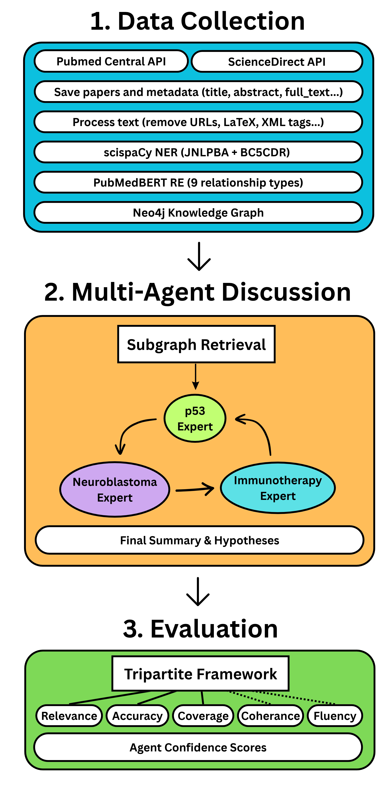
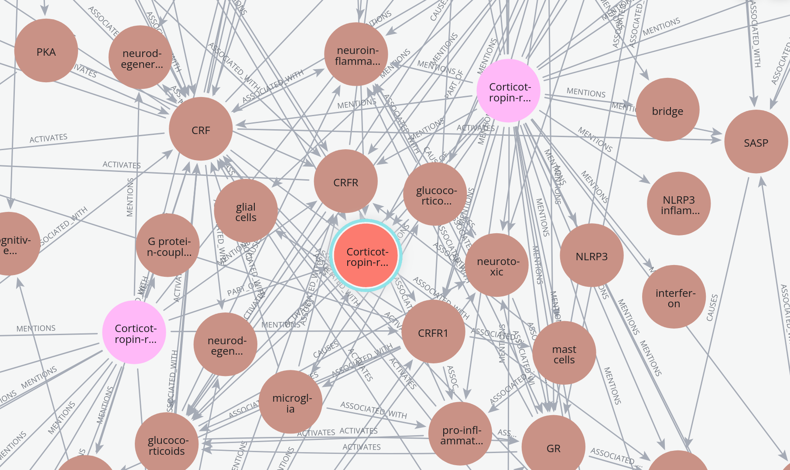

# GraphRAG Multi-Agent System for Neuroblastoma Hypotheses

This project presents a complete automated workflow for generating biomedical hypotheses. By mining literature via PubMed and ScienceDirect, it constructs a structured Neo4j knowledge graph populated with entities and relations identified by scispaCy and PubMedBERT. This graph then serves as the factual grounding for a multi-agent system (powered by AutoGen) to collaboratively evaluate and debate potential therapeutic strategies for neuroblastoma.

## Pipeline Architecture

The pipeline runs through five main stages:

1. **Data Collection:** Fetches research papers via the PubMed Central (NCBI) and ScienceDirect (Elsevier) APIs using targeted queries related to p53 and neuroblastoma.
2. **Text Preprocessing:** Cleans raw text by stripping out publisher metadata, DOIs, LaTeX commands, and concatenated section headers.
3. **Information Extraction:** 
   - Uses `scispaCy` (JNLPBA and BC5CDR models) to extract biomedical entities (genes, proteins, diseases, chemicals).
   - Uses a fine-tuned `PubMedBERT` model to extract relationships between these entities (e.g., activates, inhibits, causes).
4. **Knowledge Graph (GraphRAG):** Loads the extracted entities, relations, and text chunks into a local Neo4j graph database. 
5. **Agent Discussion and Evaluation:** Uses `AutoGen` to orchestrate a discussion between three specialist agents (p53 Expert, Neuroblastoma Expert, and Immunotherapy Expert) running on a local DeepSeek model. A tripartite framework evaluates the quality of their responses based on relevance, accuracy, coverage, coherence, and fluency.

### Architecture Diagram

<p align="center">
  
</p>

## Knowledge Graph Visualization

The extracted biomedical entities and relationships are stored in a Neo4j knowledge graph, providing the factual grounding for the multi-agent hypothesis generation system.

### Sample Neo4j Database



## Setup and Prerequisites

To run the notebook successfully, you need the following:

### 1. Environment Variables (.env)

Create a `.env` file in the root directory with the following keys:

```env
NCBI_KEY=your_pubmed_key
ELSEVIER_KEY=your_sciencedirect_key
ELSEVIER_INST=your_sciencedirect_inst_token
NEO4J_URI=bolt://localhost:7687
NEO4J_USER=neo4j
NEO4J_PASSWORD=your_password
OLLAMA_URL=http://localhost:11434
HF_TOKEN=your_huggingface_token
```

### 2. Local Services

- **Neo4j:** Start the database in the background using `neo4j console`.
- **Ollama:** Start the local LLM server using `ollama serve` (the project uses `deepseek-r1:1.5b`).

### 3. Pipeline Outputs

If the code runs successfully, it generates the following files in the `data/` folder:

- `01_pmc_papers.json` and `02_sciencedirect_papers.json` (Raw API data)
- `03_combined_papers.json` and `04_processed_papers.json` (Cleaned text)
- `05_ner_papers.json` and `06_relation_papers.json` (Extracted entities and relations)
- `07_discussion_results.json` (The full chat history and final consensus)
- Visualisations (`figure01_abstract_wordcloud.png`, `figure02_entity_distribution.png`, `figure03_relation_types.png`)
